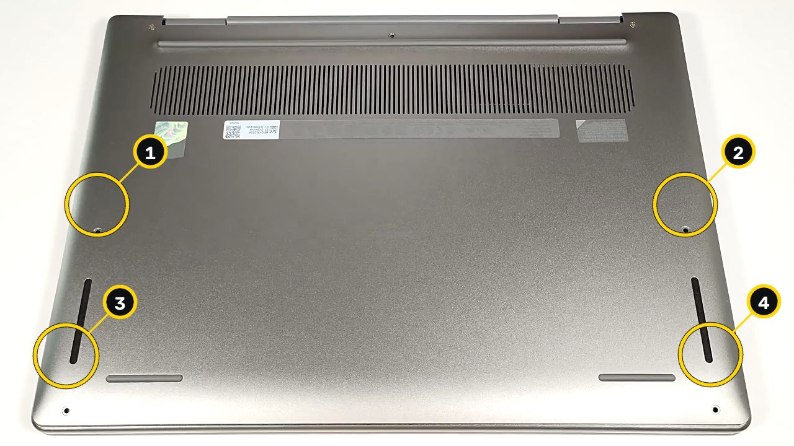
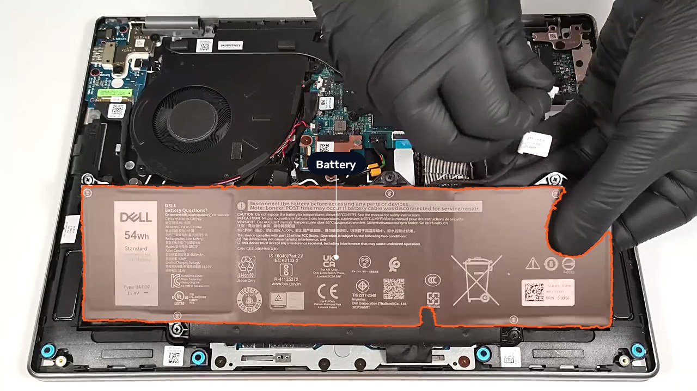
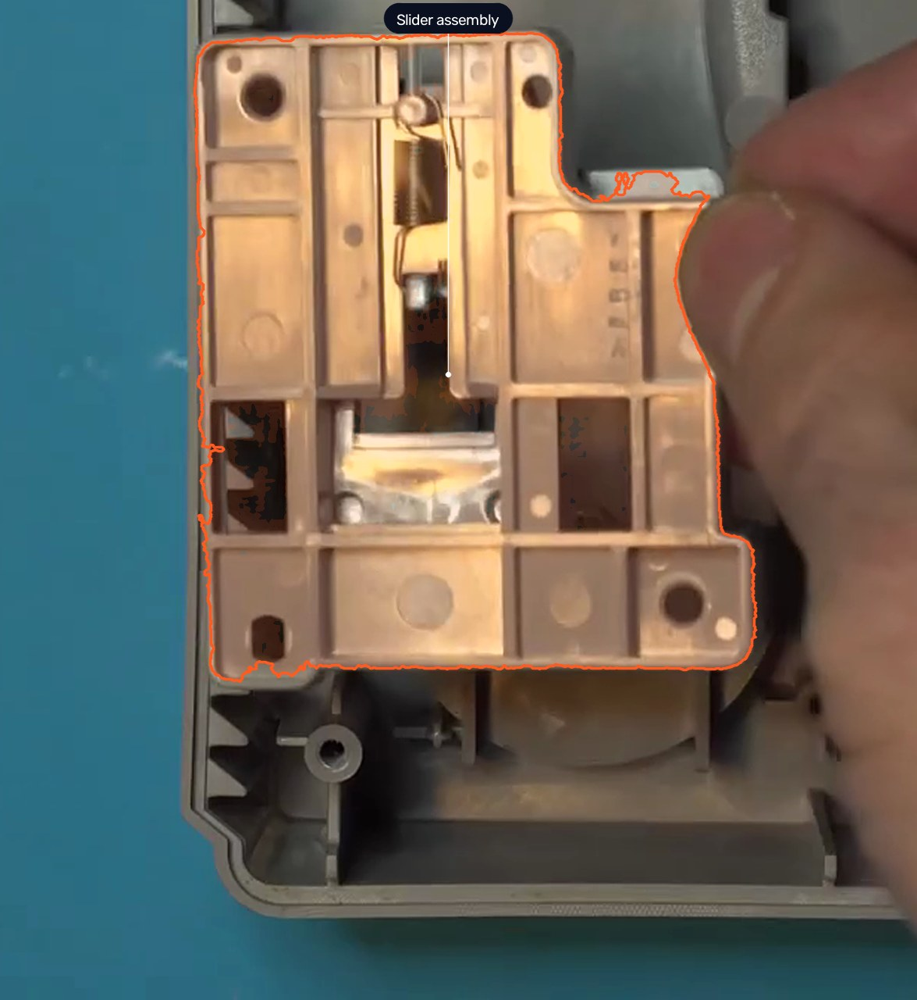
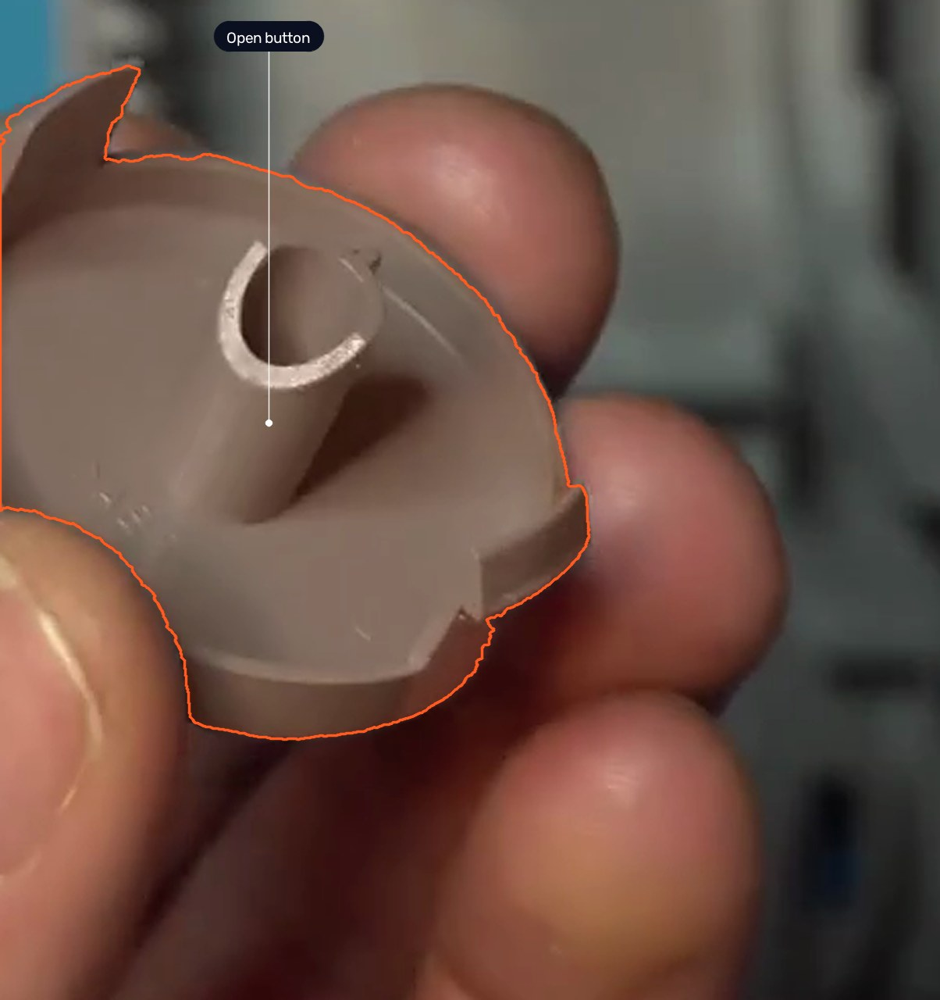
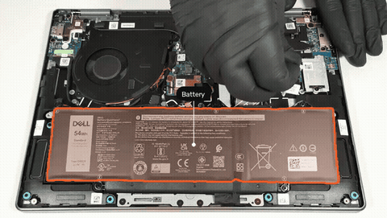
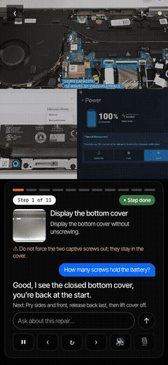

# FixScribe

**Film a repair once on your phone. FixScribe turns the video into a step-by-step guide anyone can
follow, then coaches the next person live through their camera.**

Meta Global AI Developer Hackathon · Indie track · theme: Build for Your World · built on Muse Spark,
SAM 3.1, Muse Voice and Muse Wonder through the Meta Model API.

<p>
<a href="https://www.youtube.com/watch?v=bpZMs6h1uUo"><b>▶ Watch the 3-minute film</b></a> ·
<a href="https://fixscribe-wpf3.onrender.com"><b>Open the live app</b></a> ·
<a href="#four-finished-guides-open-in-the-app"><b>Open four finished guides</b></a> ·
<a href="docs/TRY_IT.md"><b>Step-by-step for judges</b></a>
</p>

<table><tr>
<td width="25%"><br><sub><b>Laptop · step 1</b> · the four cover screws, numbered in the order they come out</sub></td>
<td width="25%"><br><sub><b>Laptop · step 5</b> · the battery, cut out by SAM 3.1 where Muse Spark pointed</sub></td>
<td width="25%"><br><sub><b>Game console · step 8</b> · the open-button slider assembly, cut out</sub></td>
<td width="25%"><br><sub><b>Game console · step 11</b> · the open button, cut out before it is greased</sub></td>
</tr></table>

<sub>All four pictures are FixScribe's own output, nothing drawn by hand: a Dell Latitude 7455
disassembly (LaptopMedia) and a PlayStation One button repair (Kytor Industries), both CC BY 3.0.</sub>

## Try it

| What | Where | Time |
|---|---|---|
| Watch what it does | [3-minute film](https://www.youtube.com/watch?v=bpZMs6h1uUo) | 3 min |
| Read a finished guide: steps, cut-out parts, numbered screws, clips, the way back | [live app](https://fixscribe-wpf3.onrender.com) → **See a finished guide** | 1 min |
| Let the live coach follow a repair video, then ask it a question | [live app](https://fixscribe-wpf3.onrender.com) → **Try the live coach** → **Use this guide's video** | 3 min |
| Point your own phone camera at a laptop and talk to the coach | same page → **Start the camera** | 2 min |
| Open the four guides it wrote: a laptop, a game console, a harp, a seat cushion | [the list below](#four-finished-guides-open-in-the-app) | 2 min |

### Four finished guides, open in the app

| Object | Guide FixScribe wrote | Open |
|---|---|---|
| Laptop | Disassemble Dell Latitude 7455: cover, battery, SSD and Wi-Fi (11 steps) | [guide](https://fixscribe-wpf3.onrender.com/guides/137c1ed0730d) · [live coach](https://fixscribe-wpf3.onrender.com/guides/137c1ed0730d/live) |
| Game console | Fix sticking power and open buttons on a PlayStation One (15 steps) | [guide](https://fixscribe-wpf3.onrender.com/guides/7628d7064780) · [live coach](https://fixscribe-wpf3.onrender.com/guides/7628d7064780/live) |
| Harp | Replace a broken brass harp string (10 steps, no screws at all) | [guide](https://fixscribe-wpf3.onrender.com/guides/0e2b78efccb9) · [live coach](https://fixscribe-wpf3.onrender.com/guides/0e2b78efccb9/live) |
| Furniture | Make a bench seat cushion, narrated in German (7 steps) | [guide](https://fixscribe-wpf3.onrender.com/guides/359ba5a7fa66) · [live coach](https://fixscribe-wpf3.onrender.com/guides/359ba5a7fa66/live) |

Every file behind them (step photos, cut-outs, clips, proof) is also in [demo/](demo/README.md).

**It is slow, not stuck.** On this free server the first visit can take about 1 minute to wake up,
the coach answers in 10 to 20 s, part marks take up to about 1 minute and a question 5 to 10 s.
Every wait ends by itself. All timings and every button: [docs/TRY_IT.md](docs/TRY_IT.md#how-long-things-take-it-is-slow-not-stuck).

## See it move

<table><tr>
<td width="62%"><br><sub><b>SAM 3.1 video</b> follows the battery through its step, so the guide knows the part really comes out here.</sub></td>
<td width="38%"><br><sub><b>The live coach</b> on the Dell guide, left alone for 17 minutes: steps 1 to 10 of 11, shown 75× faster. <a href="demo/coach/coach_dell.mp4">A real-speed clip with a question</a>.</sub></td>
</tr></table>

## The problem

**Where it started: "Which screw went where?"** While building FixScribe I took my own Xiaomi
phone apart, the battery and the camera module, to try it on a real repair. Taking it apart was the
easy half. Putting it back means remembering which screw came out of which hole, in what order, and
which connector goes first, and there was no stand to hold the phone and film at the same time.
That is the gap FixScribe fills: the video you already have becomes the order of work, with every
fastener counted back in.

More generally, most instructions are written by someone who already knows how, so they skip the
step where you get stuck. The person who just did the repair knows it best, but turning a video into
a guide takes hours. FixScribe does that part.

## What it does

| | |
|---|---|
| **1. Film it** | One phone video of any repair or assembly: electronics, appliances, furniture, bikes, cars, plumbing… Narrated or silent; saying "step" / "paso" marks where each step begins. |
| **2. A guide comes out** | Each step has its instruction, safety warnings, the part cut out on the frame by SAM 3.1, a numbered fastener map, a short loop clip and a "watch in video" jump to the exact second. |
| **3. Proof on every claim** | Each step boundary, instruction, fastener count and part is graded verified / supported / unverified, with the video seconds and words behind it. What cannot be proven is marked, not hidden. |
| **4. The way back** | The reverse guide, with a tally that every fastener taken out goes back in, and a printable fastener tray. |
| **5. Safety first** | Fixed rules in `app/safety.py` refuse professional-only jobs (gas, mains panel, airbag, refrigerant, high-voltage battery, microwave). A model may make a decision stricter, never looser. |
| **6. Live coach** | Point the phone at the job: it says which step you are on, marks the parts, and takes voice commands or questions. Answers name their step and play that moment of the video. |

## How it uses Meta models

Every call goes through one door, `app/meta_client.py`: retries, 429 backoff, a global and a per-job
budget, and a spend log per stage.

| Model | Job in FixScribe |
|---|---|
| `muse-spark-1.3` | identifies the object, category, task and hazards; watches the whole video with the transcript and writes the steps; re-reads unclear steps on timecoded clips; points at parts; checks every mark; follows the live camera; answers questions |
| `sam-3.1` (images) | cuts out the part Spark points at; finds fastener candidates on the frame and on zoomed tiles |
| `sam-3.1` (video) | follows each part and fastener through its step, so a fastener counts only if it appears or disappears where the step says |
| `muse-voice-transcribe-1.0` | timestamped turns; the spoken "step" / "paso" become the step cuts; hears the user in the coach |
| `muse-wonder-1.0` | optional agent (`ENABLE_INSPECTOR`): looks at frames, points with SAM, adds steps and asks the person when unsure. On one real 8.5-minute video it filed 15 steps with 5 SAM-proven parts in 13 turns, for $0.69 |
| MMS-TTS (Meta open weights, CC-BY-NC 4.0, local) | reads the film and the coach aloud; `python -m scripts.get_voice` installs it, otherwise the device voice is used |

Unexpected uses: **SAM 3.1 as a fastener counter** (candidates from SAM, followed over time by SAM
video, confirmed by Spark by number, never by guessing coordinates); **voice turns as step cuts**
(the narration is the editing tool); **an agent with eyes** (Muse Wonder uses SAM and frames as
tools and stops to ask a person).

## How it works

```
phone video ─► ingest ─► transcribe ─► identify ─► signals ─► scenes ─► analyze ─► fusion ─► refine
  (ffmpeg)    (Muse Voice) (Spark)      (OpenCV)   (code)    (Spark)    (code)    (Spark)
           ─► plan ─► safety ─► frames ─► perception ─► motion ─► proof ─► narrate ─► publish ─► learn
              (code)  (rules)   (code)   (Spark+SAM)  (SAM video) (code)   (Spark)    guide.json
```

17 stages, one process per job, one folder per job (`data/jobs/<id>/`), one Pydantic model per file,
every file written atomically. A failed job resumes at the stage that failed without paying again
for the stages before it. Optional stages add a warning and the job goes on; only ingest, scenes,
analyze, plan, safety and publish can stop a job, and then the page shows one clear sentence.

The live coach runs in two tiers: the **step** (a camera frame plus the guide's photos of the
previous, current and next step go to Spark; one odd frame never moves it, a different step needs
two frames in a row) and the
**marks** (Spark names and points, SAM 3.1 cuts out, shown dashed; Spark checks again, shown solid).
Next / back / repeat run without any model; anything phrased as a question goes to Spark.

Details: [docs/ARCHITECTURE.md](docs/ARCHITECTURE.md) and [docs/ALGORITHM.md](docs/ALGORITHM.md).

## Evaluation

Answer keys written by eye, before tuning. The first three exams score saved answers with no Meta
calls; the coach exam spends credits.

| Exam | Command | Result |
|---|---|---|
| Parts and fasteners on 20 photos | `python -m eval.detect_score` | recall 0.83 → **0.89**, precision 0.98 → **1.00**, perfect photos 14 → **16** of 20 |
| Fasteners in a real 16-step furniture video (720p) | `python -m eval.video_score` | recall 0.75, precision 1.00: no invented fastener |
| Whole pipeline on labelled videos | `python -m eval.run_eval --reuse` | step F1, boundaries within ±2 s, fastener counts, seconds and dollars per stage |
| Live coach, a frame every 4 s | `python -m eval.coach_exam <video> --real --walk` | below |

Live coach, one phone repair and one furniture assembly (2026-11-01):

| Measure | Phone | Furniture |
|---|---|---|
| Right step, up to 8 s late | 88 % | 95 % |
| Right step at that exact moment | 76 % | 80 % |
| Right step, steps not used for tuning | 69 % | 65 % |
| Marks on the right part | 93 % | 74 % |

Changing one thing at a time on the phone video (2026-11-02): the step's own part marked in 7 → **10**
of 11 steps, marks median 27.1 s → **20.0 s**, marks right 92 % → 89 % (not every number went up).
Typed questions: 3 of 3 right in 2–4 s. An answer from the camera takes about 8 s.

**Honest limits.** Precision 1.00 is on 20 photos; on a live camera the coach still marks the wrong
part 11–26 % of the time. Two coach videos are few, and the key's author also tuned the coach.
Fasteners hidden in wood or under a hand cannot be seen: then the count comes from the analysis
and the guide says so. Small screws need 1080p or 4K, and the guide warns when the video is smaller.
An 8.5-minute video took 14 to 30 minutes and $0.69 to $1.47 to turn into a guide, depending on the
version of the pipeline.

## Built to survive real input

964 tests, Meta always mocked. They include phone video as it really is (rotated, variable frame
rate, 10-bit HDR, 60 fps, too short, not a video) and model answers as they really come back
(reversed or negative times, invented categories and hazards, runaway text, broken JSON): every job
ends with a guide or one clear sentence, never a crash.

## Safe to leave public

No login: a job's unguessable link is its key, and no route lists jobs. The original video and raw
model answers are never served; uploads open only as real video files; the place of filming is
dropped from working copies; every path to Meta has a budget; at most two videos are processed at
once while the rest wait in line; per-visitor limits can be turned on from the host's panel. See
[docs/ARCHITECTURE.md](docs/ARCHITECTURE.md#limits-on-a-public-server).

## Run it locally

```bash
python3.12 -m venv .venv
.venv/bin/pip install -e ".[dev]"
cp .env.example .env            # then add your Meta key
.venv/bin/uvicorn app.main:app --reload
```

Then open `http://127.0.0.1:8000` on that computer (or the computer's address from a phone on the
same wifi) and upload a video. No key? `python scripts/demo_job.py`
builds a guide with the real pipeline and a fake Meta client.

**Open a sample guide in the app, no key needed:** start the server with
`DEMO_JOB=137c1ed0730d .venv/bin/uvicorn app.main:app` and the landing links to the Dell laptop guide
from [demo/](demo/README.md) (read-only). Any other folder in `demo/` works the same way. Its live
coach (button "Use this guide's video") needs a Meta key; the camera needs https or 127.0.0.1.

```bash
.venv/bin/pytest -q             # tests, Meta mocked
.venv/bin/ruff check .          # lint
docker build -t fixscribe . && docker run --env-file .env -p 8000:8000 fixscribe
```

Hosting it yourself (Render, free): [docs/DEPLOY.md](docs/DEPLOY.md).

## Repository map

| Folder | What is in it |
|---|---|
| `app/` | FastAPI app: `main.py`, `routes/`, the pipeline stages in `pipeline/`, the agent in `agent/`, `meta_client.py` (the only door to Meta), `schemas.py`, `safety.py` |
| `web/` | Jinja2 templates, plain JavaScript and CSS, landing photos and drawings |
| `prompts/` | one versioned file per model task (`analyze_v1.md`, `live_v2.md`, …) |
| `domains/` | one JSON profile per kind of object: fasteners, parts, tools, safety checks |
| `eval/` | answer keys and exams ([eval/README.md](eval/README.md)) |
| `tests/` | the test suite, Meta always mocked |
| `scripts/` | tools to run a video, pack the sample guide, draw the landing ([scripts/README.md](scripts/README.md)) |
| `docs/` | architecture, algorithm, design, deploy and hackathon notes ([docs/README.md](docs/README.md)) |
| `tasks/` | every Muse Code task, review and report ([tasks/README.md](tasks/README.md)) |
| `demo/` | four sample guides made from internet videos, one per kind of object ([demo/README.md](demo/README.md)) |

## Built during the hackathon (Oct 26 – Nov 4, 2026)

All code in this repository was written during the hackathon, from Oct 26, 2026. Muse Code (Meta's
coding agent, running `muse-spark-1.3`) wrote the first version of several stages from small written
tasks: 16 of the commits say "Written by Muse Code". From Oct 27 the code was written with
other AI coding assistants. Every Muse Code task, review and report is kept in [`tasks/`](tasks/).

## License and credits

MIT. See [LICENSE](LICENSE). The MMS-TTS voice model is CC-BY-NC 4.0 and is downloaded separately.
The repair videos in `demo/` and in the film are from Wikimedia Commons under CC BY 3.0; each one is
credited in [demo/README.md](demo/README.md).
