# Sample guides

**See what FixScribe makes without installing anything.** Four repair and assembly videos from the internet, each run once through the whole FixScribe
pipeline with no editing by hand. Every file in a folder is the pipeline's own output: the guide
(`guide.json`), a photo per step with the part SAM 3.1 cut out and the numbered fasteners
(`steps/NN_overlay.jpg`), a loop clip per step (`steps/NN.mp4`), the proof for each claim
(`proof.json`) and every stage's intermediate file.

What to look at in each step photo: the **part outlined** is SAM 3.1's cut-out of what Muse Spark
pointed at, and the **numbered yellow circles** are the fastener map (screws, clips, staples) in the
order they come out.

**Open them in the live app:** [laptop](https://fixscribe-wpf3.onrender.com/guides/137c1ed0730d) · [game console](https://fixscribe-wpf3.onrender.com/guides/7628d7064780) ·
[harp](https://fixscribe-wpf3.onrender.com/guides/0e2b78efccb9) · [seat cushion](https://fixscribe-wpf3.onrender.com/guides/359ba5a7fa66) (free server: the first visit can take a
minute). To open them locally: `DEMO_JOB=137c1ed0730d,7628d7064780,0e2b78efccb9,359ba5a7fa66` and
start the server; each guide is at `/guides/<folder>`, read-only.

| Folder | Object | Guide FixScribe wrote | Steps | Put back | Meta cost |
|---|---|---|---|---|---|
| [`137c1ed0730d`](137c1ed0730d/) | Laptop (electronics, take apart) | Disassemble Dell Latitude 7455 - Cover, Battery, SSD and Wi-Fi | 11 | 8 | $1.70 |
| [`7628d7064780`](7628d7064780/) | Game console (electronics, repair) | Fix Sticking and Squeaking Power and Open Buttons on Sony PlayStation One | 15 | 2 | $2.50 |
| [`0e2b78efccb9`](0e2b78efccb9/) | Musical instrument (no screws at all) | Replace a Broken Brass Harp String | 10 | 2 | $2.45 |
| [`359ba5a7fa66`](359ba5a7fa66/) | Furniture (narrated in German) | Make a Bench Seat Cushion | 7 | 6 | $1.92 |

Each guide took 17 to 27 minutes, two running at a time. The cost includes the optional Muse Wonder
agent, which checked each guide after it was written.

## Disassemble Dell Latitude 7455 - Cover, Battery, SSD and Wi-Fi

<table><tr>
<td width="33%"><a href="137c1ed0730d/steps/01.mp4">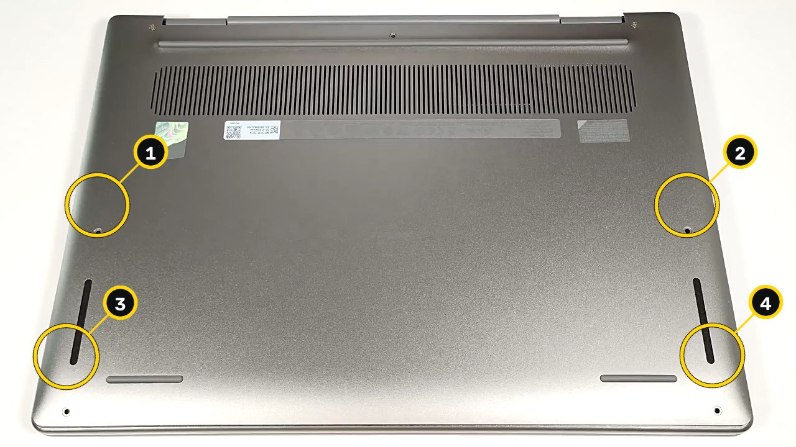</a> <b>Step 1</b> · Display the bottom cover</td>
<td width="33%"><a href="137c1ed0730d/steps/04.mp4">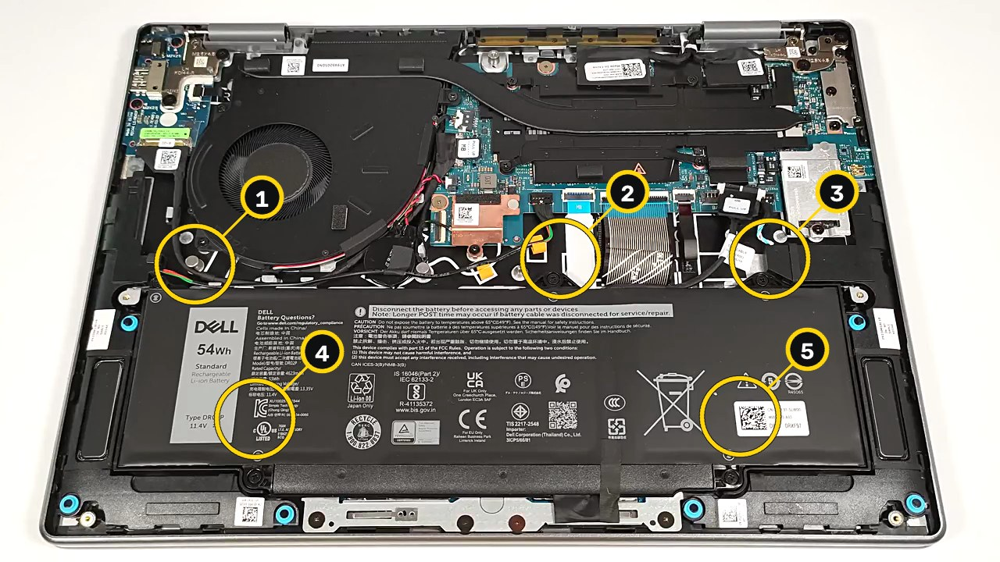</a> <b>Step 4</b> · Unscrew battery</td>
<td width="33%"><a href="137c1ed0730d/steps/05.mp4">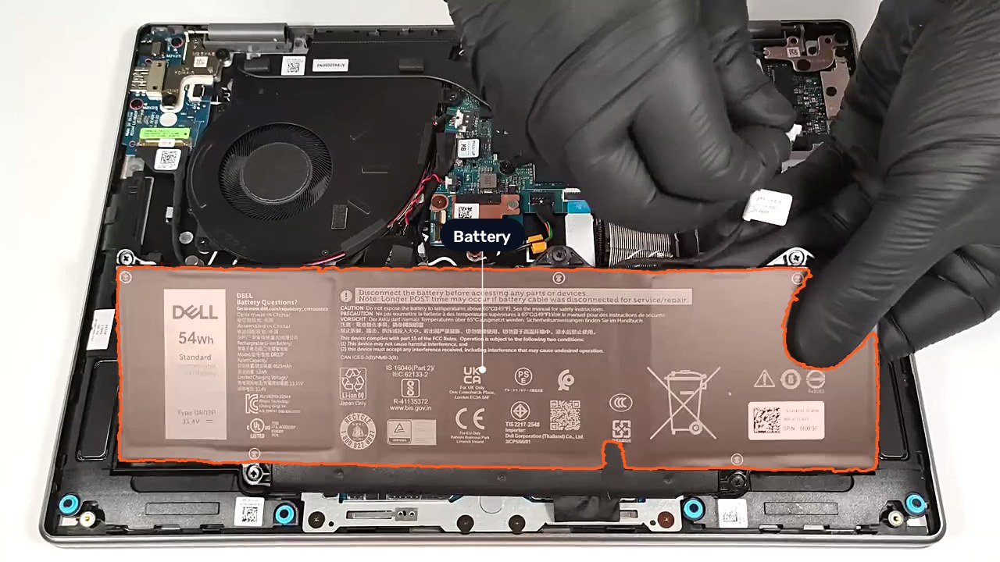</a> <b>Step 5</b> · Remove battery</td>
</tr></table>

Tap a photo to play that step's loop clip.

1. Display the bottom cover without unscrewing.
2. Pry the sides and front with a thin plastic tool, release the back last, then lift the bottom cover off.
3. Unplug the battery connector from the main board.
4. Undo the five Phillips-head screws securing the battery to the base.
5. Lift the 54Wh battery out of the chassis.
6. Inspect the soldered LPDDR5X memory on the board.
7. Undo the single screw holding the SSD metal plate.
8. Pull the SSD shroud forward and lift it off to expose the thermal pad inside.
9. Locate the Wi-Fi card close to the cooling fan.
10. Remove the screw and slide the Wi-Fi cover to the left to lift it off.
11. Inspect the fan, single long heat pipe, heatsink and heat spreader.

Source: [How to open Dell Latitude 7455 - disassembly and upgrade options.webm](https://commons.wikimedia.org/wiki/File:How_to_open_Dell_Latitude_7455_-_disassembly_and_upgrade_options.webm) by LaptopMedia, CC BY 3.0 (https://creativecommons.org/licenses/by/3.0). Changes: re-encoded to 1080p, 30 fps.

## The live coach on the Dell guide

[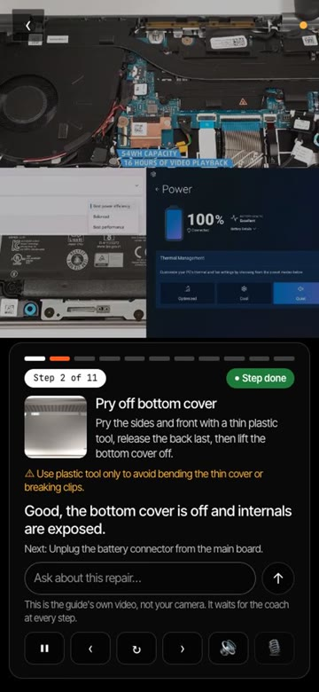](coach/coach_dell.mp4)

[Watch the clip (29 s)](coach/coach_dell.mp4). The coach's "Use this guide's video" mode, recorded
on 2026-11-04 in a phone-sized browser: the guide's own video plays in place of the camera and waits
for the coach at each frame. The coach says which step it sees (1, then 2, then 6 of 11) and what
comes next, and a typed question ("How many screws hold the battery?") gets "Step 4: Five
Phillips-head screws…" with a button that plays that second of the video. The clip is cut from a
7-minute take in which the video was moved ahead by hand; each answer took about 17 s that day, so
the waits are cut out and the rest plays at double speed.

[Watch the coach alone (31 s, 30× speed)](coach/coach_dell_alone.mp4): the same mode left to run on
its own for 17 minutes, nobody touching anything. The coach follows the video from step 1 to step 10
of 11 by itself, marking parts such as the battery connector and the soldered memory on the way. It
did not reach step 11: each answer took about 17 s that day, and the video ended first.

## Fix Sticking and Squeaking Power and Open Buttons on Sony PlayStation One

<table><tr>
<td width="33%"><a href="7628d7064780/steps/02.mp4">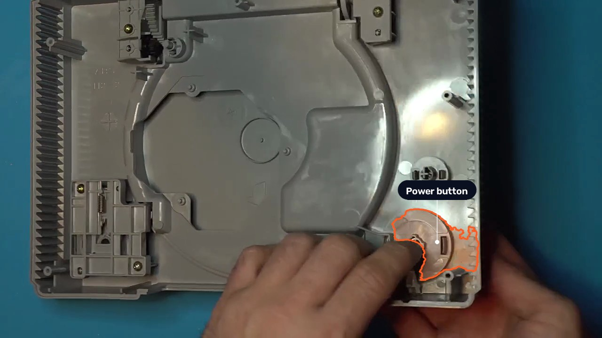</a> <b>Step 2</b> · Unclip</td>
<td width="33%"><a href="7628d7064780/steps/08.mp4">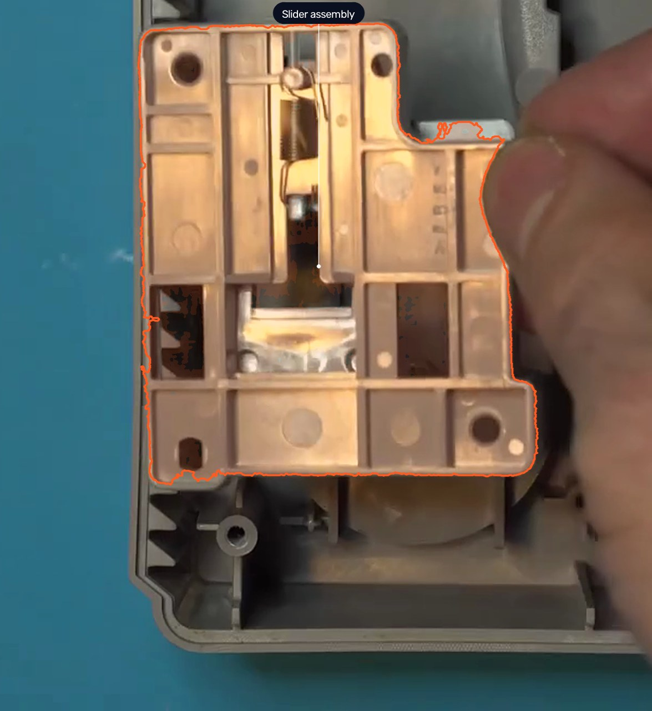</a> <b>Step 8</b> · Remove slider assembly</td>
<td width="33%"><a href="7628d7064780/steps/11.mp4">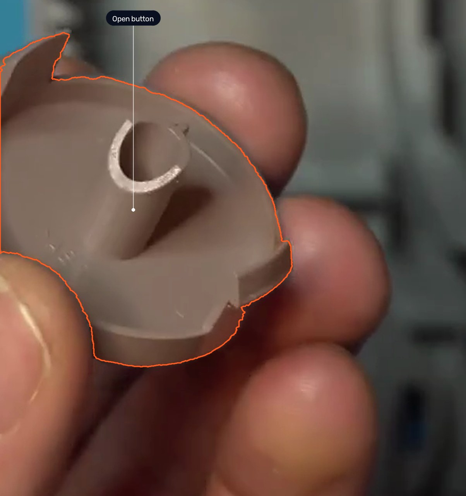</a> <b>Step 11</b> · Lubricate open button</td>
</tr></table>

Tap a photo to play that step's loop clip.

1. Lift off the upper shell and set aside the lower half.
2. Unclip and remove the open button.
3. Inspect the power button spring, clips, and center post for rub marks and dust.
4. Apply a very thin layer of silicone grease to the power button rub areas with your finger.
5. Lubricate the spring contact lightly and place the spring back on the center post in the correct direction.
6. Display the empty power button housing.
7. Remove the two Phillips screws holding the open-button slider assembly.
8. Pull the spring-loaded slider assembly straight out of the shell.
9. Rub silicone grease into all plastic-on-plastic contact and wear areas of the slider.
10. Pop the open button out of the shell.
11. Apply a very thin layer of silicone grease to the open button contact areas, slide area, and shaft.
12. Fit the open button into its slider housing.
13. Reattach the slider spring and reinsert the slider assembly into position.
14. Hold the assembly down and tighten only the lower screw.
15. Flip the shell over and press the Power and Open buttons to verify smooth return.

Source: [How to Fix Sticking or Squeaking Buttons on the PlayStation 1.webm](https://commons.wikimedia.org/wiki/File:How_to_Fix_Sticking_or_Squeaking_Buttons_on_the_PlayStation_1.webm) by Kytor Industries, CC BY 3.0 (https://creativecommons.org/licenses/by/3.0). Changes: re-encoded to 1080p, 30 fps.

## Replace a Broken Brass Harp String

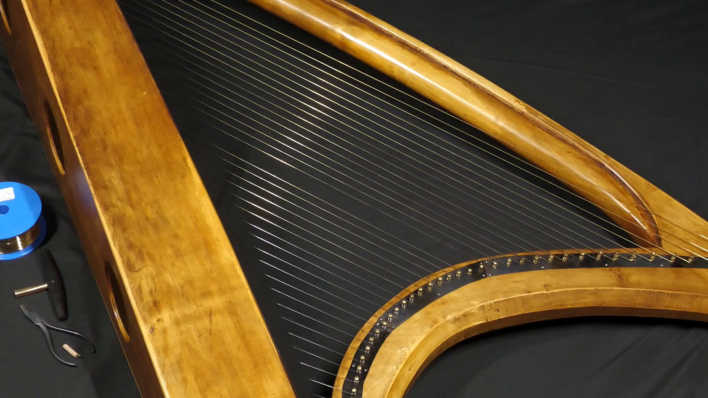

A harp has no screws, so its steps carry no fastener map.

1. Leave the harp resting on the ground.
2. Pull the old broken string off the harp and save it for reuse.
3. Turn the harp down onto its right side to access pin, shoe and back.
4. Feed wire off the reel into the front hole and grab it through the back hole.
5. Loop the wire once around the toggle, fold it back in a hairpin and tighten the knot with pliers.
6. Tighten the toggle knot with pliers and pull the wire through to seat the toggle.
7. Cut the wire about 5 cm above the pin and bend a small hook.
8. Turn the harp back upright.
9. Hook the wire hook onto the tuning pin.
10. Wind the string up with the tuning key and bring to pitch.

Source: [Replacing a wire string on an Irish harp 2022.webm](https://commons.wikimedia.org/wiki/File:Replacing_a_wire_string_on_an_Irish_harp_2022.webm) by Simon Chadwick, CC BY 3.0 (https://creativecommons.org/licenses/by/3.0). Changes: re-encoded to 1080p, 30 fps.

## Make a Bench Seat Cushion

<table><tr>
<td width="33%"><a href="359ba5a7fa66/steps/01.mp4">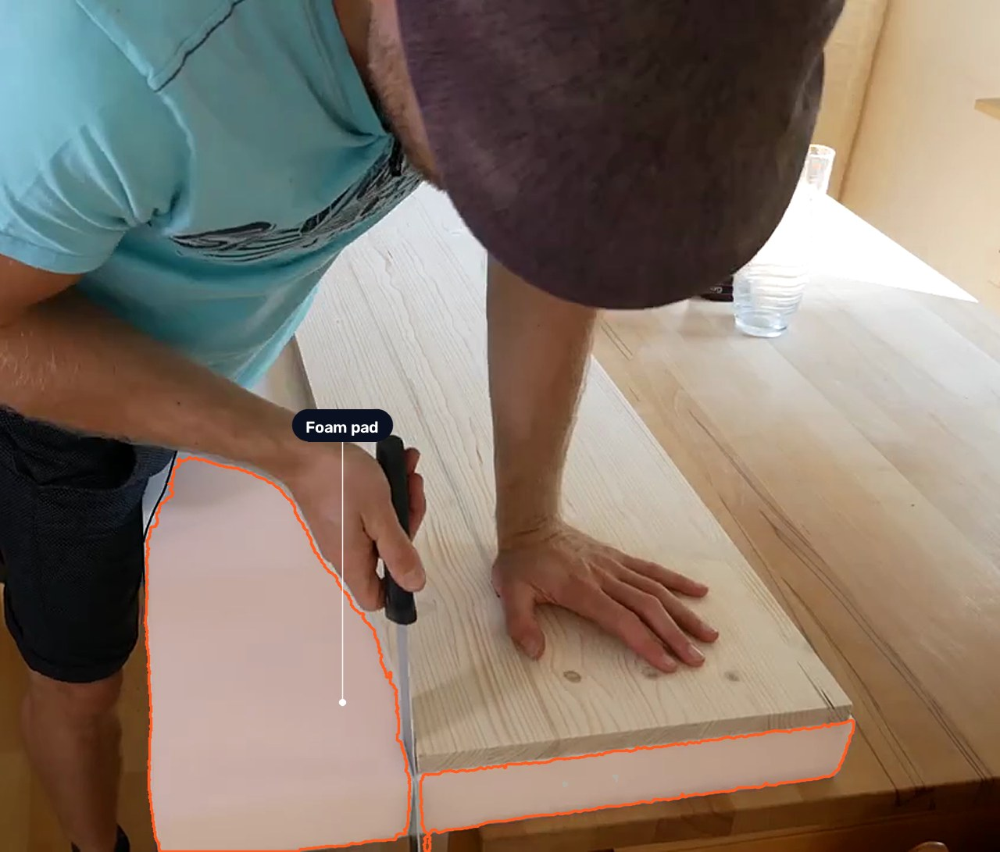</a> <b>Step 1</b> · Cut foam to board size</td>
<td width="33%"><a href="359ba5a7fa66/steps/03.mp4">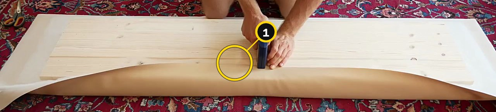</a> <b>Step 3</b> · Staple center of cover</td>
<td width="33%"><a href="359ba5a7fa66/steps/06.mp4">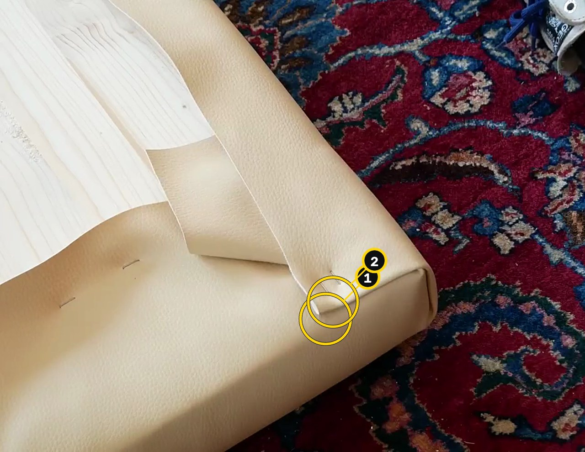</a> <b>Step 6</b> · Staple corner fold</td>
</tr></table>

Tap a photo to play that step's loop clip.

1. Place the wooden board on the foam and cut the foam to size with a cake knife, staying square.
2. Stack wood board on foam pad over batting and faux leather with overhang on all sides.
3. Pull batting then faux leather tight at center and staple twice to the board.
4. Pull the faux leather tight at the center of the opposite side and staple it to the board.
5. Fold the corner batting over the wood edge and tuck the leather into a square gift-wrap fold.
6. Hold the folded corner tight and drive two staples to fix it.
7. Re-tension the cover all around, staple evenly, and trim overlapping bulges with a carpet knife.

Source: [Polster beziehen, polstern DIY Tutorial Anleitung.webm](https://commons.wikimedia.org/wiki/File:Polster_beziehen,_polstern_DIY_Tutorial_Anleitung.webm) by Sebastian Wallroth, CC BY 3.0 (https://creativecommons.org/licenses/by/3.0). Changes: re-encoded to 1080p, 30 fps.

## Licences

The source videos are from Wikimedia Commons under the licences named above; the derived
frames, clips and cut-outs in each folder carry the same licence and credit. The FixScribe code is MIT.
